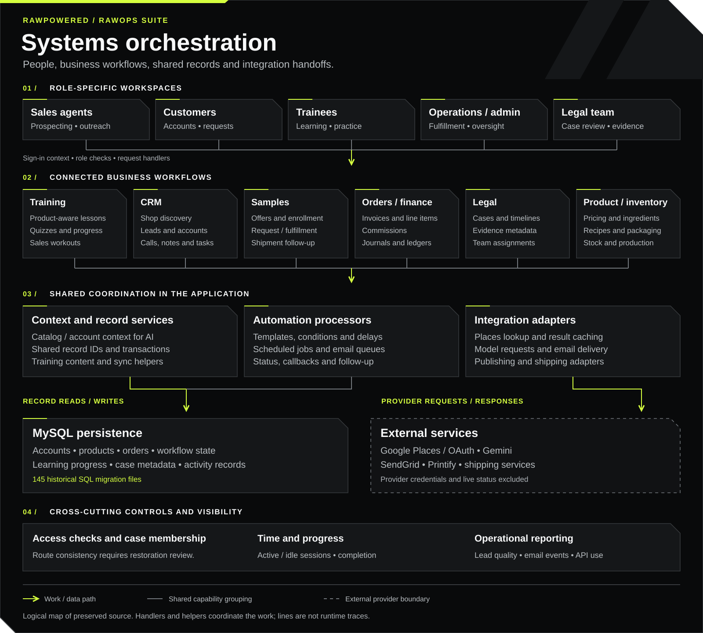

# RawOps Suite

**A business platform connecting product knowledge, sales activity, customer relationships and internal operations.**

I built RawOps Suite around the work of a product business: preparing agents, finding shops, managing outreach, fulfilling samples, serving accounts and organizing legal records. My work spans the interfaces, data model, APIs, automation and operational reporting.

   

**Project stage:** preserved history of a previously functional business system. The public archive combines de-identified source, genuine screenshots and firsthand usage context. Current deployment and provider connectivity have not been revalidated.

<h2 id="evidence"></h2>

You can inspect the application screens, follow the workflows and read the code behind them.

| Historical record | What you can inspect |
|:--|:--|
| **29 September 2025: operating overview** | The captured dashboard displays **51 leads, 10 sales agents and 16 users in training** in its selected window.  |
| **20 October 2025: CRM data quality** | **143 detailed leads, 241 incomplete leads and 69 email chains** appear in the capture below. It shows the system exposing incomplete records and follow-up coverage. |
| **Legal case organization** | I used the workspace to retain chronology and evidence and organize material for lawyers, reducing the additional sorting needed to review the records.  |

Each snapshot reflects its own date and filter window. Revenue and conversion attribution are outside this evidence. The legal account describes my experience; no measured time or fee savings are claimed.

<table>
<tr>
<td width="50%" valign="top">

<strong>Make the next action visible.</strong> Lead completeness, missing contact fields and follow-up chains.

</td>
<td width="50%" valign="top">

<strong>Put assistance where agents work.</strong> Templates, assisted writing, tone and presentation controls.

</td>
</tr>
</table>

<h2 id="features"></h2>

**One sales journey:** product-aware training → shop discovery → lead record → reviewed email draft → sample offer → fulfillment → follow-up → store account and continuing service.

Each step has its own records, statuses and user actions. Sample outreach does not automatically create a fulfillment job or a customer account.

| Capability | What I built | Inspect the evidence |
|:--|:--|:--|
| **Product-aware training** | Catalog-backed prices, product details and calculations; synchronization tools; lessons, quizzes and sales practice. Education evolved with price and ingredient changes. |    |
| **Shop discovery and CRM** | Category/location searches, cached place details, lead records, assignment, notes, calls, tasks and follow-up context. |    |
| **AI chat and email drafting** | Product and account context for chat; catalog and lead activity for drafts; templates, saved drafts and behavior-aware follow-ups. |    |
| **Samples and customer accounts** | Free-sample offers, enrollment, request handling, fulfillment, scheduled communication and store-account workflows. |    |
| **Agent digital business cards** | Personalized cards, contact downloads, QR/vCard support, customer signup and sample links carrying agent context. |   |
| **Legal case workspace** | Case timelines, evidence metadata, documents, notes, parties, team assignments, access requests and session activity. |    |
| **Time, progress and metrics** | Training completion, active/idle time, long-session alerts, pipeline visibility, lead quality, email events and API usage. |    |

The walkthrough distinguishes captured interface behavior from source-backed capabilities. The assistant screenshot shows its welcome state; the linked handlers show context assembly and model integration.

<h2 id="product-learning"></h2>

**For design reviewers: follow the product knowledge.** Product formulation and catalog tools define the operational detail; LMS authoring, lessons and practice help agents understand it; email templates and assisted drafts bring relevant information into customer conversations.

The case explains shared values, authored content, interface choices and review of assisted output. It includes genuine learning and composer captures, source references and an interview walkthrough relevant to AI Tutor, Design roles. Recipe-to-catalog publication remains an editorial handoff in this diagram; automatic propagation across every edit path is unverified.

<h2 id="scope"></h2>

 

<strong>Expand the wider feature inventory</strong>

| Workspace | Additional depth | Review |
|:--|:--|:--|
| Product and production | Product groups, ingredients, recipes, packaging, stock, pricing tiers and work-order interfaces |   |
| Orders and commissions | Invoices, persisted line items, commission tiers, agent books and financial summaries |  |
| Accounting and suppliers | Expenses, reversals, journals, ledgers, suppliers, tax records and financial-reporting surfaces |  |
| Communication automation | Reusable templates, conditions, delays, queued work, provider callbacks and engagement records |  |
| Customer and team portals | Registration, verification, reset flows, account/request history and role-specific workspaces |  |
| Web experience | Shared navigation, responsive layouts, metadata, structured data and a dated Lighthouse capture |  |

   

<h2 id="engineering"></h2>

The implementation is available for review: **437 PHP files, 33 standalone JavaScript files, 122 API source files and 145 SQL migration files**. These overlapping inventory counts describe the archive's scope.

| Problem addressed | Design represented in the code | Go deeper |
|:--|:--|:--|
| Outreach appeared as fulfillment work before a request existed | Separate lead-linked enrollment from physical sample requests; retain follow-up context |  |
| Invoice, commission and finance records needed consistent references | Validate persisted identifiers, coordinate transaction ownership and notify after commit |  |
| Automated communication needed a traceable lifecycle | Separate templates, conditions, queue processing, provider callbacks and reporting |  |

**Security review:** roles, case membership, session identity and data boundaries are documented. The archive also documents historical gaps, including broader access in the evidence-locker route. Restoration requires consistent case-level authorization and a full deployment review.

**Publication checks:** All included PHP and standalone JavaScript files passed syntax inspection; Gitleaks reported no detected secrets. These checks do not execute the business workflows.

<h2 id="review"></h2>

| Your opening | A useful place to start |
|:--|:--|
| **CRM, business systems or support operations** |   |
| **AI Tutor, Design or learning experience** |  |
| **AI product or API integration** |   |
| **Learning platforms or sales enablement** |   |
| **Internal tools, operations or technical product delivery** |    |

**In an interview, ask me to trace one record through the system.** I can explain the business need, interface, data relationships, automation, failure handling and the evidence preserved here. Useful starting points are a sample enrollment, a product change feeding training, or a case timeline prepared for review.

 

<h2 id="preservation"></h2>

Company/product identity, customer records, private legal content, credentials and runtime configuration are excluded. Screenshots retain historical UI states with opaque redactions. Original evidence files remain private.

The code is a historical source archive. Older provider/model endpoints, migrations and security boundaries require review before restoration.

 

The main branch contains the current portfolio presentation.

 
