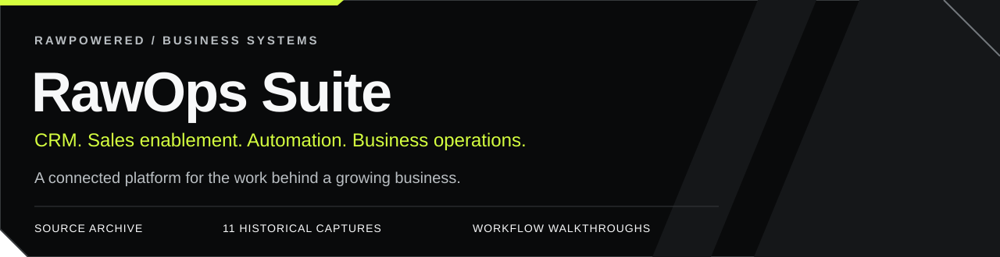
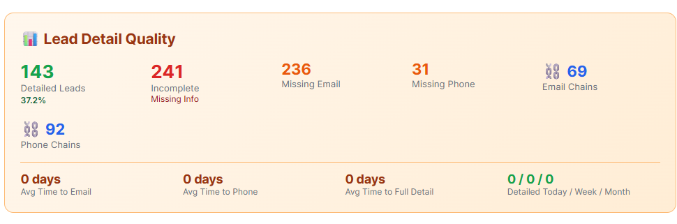
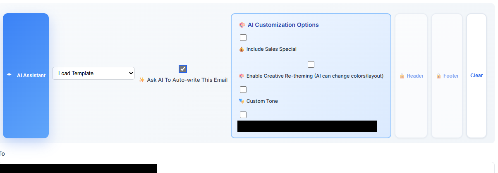

# RawOps Suite

**A business platform connecting product knowledge, sales activity, customer relationships and internal operations.**

I built RawOps Suite around the work of a product business: preparing agents, finding shops, managing outreach, fulfilling samples, serving accounts and organizing legal records. My work spans the interfaces, data model, APIs, automation and operational reporting.

   

[Workflow walkthrough](docs/FEATURE-WALKTHROUGH.md) · [11 historical captures](docs/evidence/GALLERY.md) · [Source review](docs/SOURCE-REVIEW.md) · [Security and privacy](docs/SECURITY-AND-PRIVACY.md)

**Project stage:** preserved history of a previously functional business system. The public archive combines de-identified source, genuine screenshots and firsthand usage context. Current deployment and provider connectivity have not been revalidated.

<h2 id="evidence"></h2>

You can inspect the application screens, follow the workflows and read the code behind them.

| Historical record | What you can inspect |
|:--|:--|
| **29 September 2025: operating overview** | The captured dashboard displays **51 leads, 10 sales agents and 16 users in training** in its selected window. [View the original interface, redacted](docs/evidence/GALLERY.md#operating-overview--29-september-2025). |
| **20 October 2025: CRM data quality** | **143 detailed leads, 241 incomplete leads and 69 email chains** appear in the capture below. It shows the system exposing incomplete records and follow-up coverage. |
| **Legal case organization** | I used the workspace to retain chronology and evidence and organize material for lawyers, reducing the additional sorting needed to review the records. [Firsthand account, interface and source](docs/FEATURE-WALKTHROUGH.md#6-organize-legal-work-for-review). |

Each snapshot reflects its own date and filter window. Revenue and conversion attribution are outside this evidence. The legal account describes my experience; no measured time or fee savings are claimed.

<table>
<tr>
<td width="50%" valign="top">

<strong>Make the next action visible.</strong> Lead completeness, missing contact fields and follow-up chains.

</td>
<td width="50%" valign="top">

<strong>Put assistance where agents work.</strong> Templates, assisted writing, tone and presentation controls.

</td>
</tr>
</table>

[Browse all 11 captures: training, chat, digital cards, legal, operations and website audit →](docs/evidence/GALLERY.md)

<h2 id="features"></h2>

**One sales journey:** product-aware training → shop discovery → lead record → reviewed email draft → sample offer → fulfillment → follow-up → store account and continuing service.

Each step has its own records, statuses and user actions. Sample outreach does not automatically create a fulfillment job or a customer account.

| Capability | What I built | Inspect the evidence |
|:--|:--|:--|
| **Product-aware training** | Catalog-backed prices, product details and calculations; synchronization tools; lessons, quizzes and sales practice. Education evolved with price and ingredient changes. | [Training screen](docs/evidence/GALLERY.md#training-progression--14-september-2025) · [Synchronization service](required/training-auto-sync.php) · [Dynamic lesson content](required/shortcode-engine.php) |
| **Shop discovery and CRM** | Category/location searches, cached place details, lead records, assignment, notes, calls, tasks and follow-up context. | [CRM capture](docs/evidence/GALLERY.md#crm-data-quality--20-october-2025) · [Places adapter](api/google-places-proxy.php) · [Agent workspace](onboarding/sales-agent/leads.php) |
| **AI chat and email drafting** | Product and account context for chat; catalog and lead activity for drafts; templates, saved drafts and behavior-aware follow-ups. | [Assistant interface](docs/evidence/GALLERY.md#sales-assistant--24-october-2025) · [Chat context](api/ai-chat-streamlined.php) · [Email composer](api/ai-email-composer.php) |
| **Samples and customer accounts** | Free-sample offers, enrollment, request handling, fulfillment, scheduled communication and store-account workflows. | [Workflow explanation](docs/FEATURE-WALKTHROUGH.md#4-carry-a-free-sample-through-the-customer-journey) · [Sample suite](api/sample-suite.php) · [Store accounts](onboarding/sales-agent/accounts.php) |
| **Agent digital business cards** | Personalized cards, contact downloads, QR/vCard support, customer signup and sample links carrying agent context. | [Historical card](docs/evidence/GALLERY.md#agent-digital-business-card--24-october-2025) · [Public card implementation](agent/card.php) |
| **Legal case workspace** | Case timelines, evidence metadata, documents, notes, parties, team assignments, access requests and session activity. | [Redacted timeline](docs/evidence/GALLERY.md#legal-evidence-timeline--6-october-2025) · [Case service](required/legal-case-service.php) · [Metadata handler](api/legal/update-evidence-metadata.php) |
| **Time, progress and metrics** | Training completion, active/idle time, long-session alerts, pipeline visibility, lead quality, email events and API usage. | [Measurement walkthrough](docs/FEATURE-WALKTHROUGH.md#7-make-progress-and-operational-gaps-visible) · [Training heartbeat](api/training-heartbeat.php) · [Usage reporting](api/admin-usage-analytics.php) |

The walkthrough distinguishes captured interface behavior from source-backed capabilities. The assistant screenshot shows its welcome state; the linked handlers show context assembly and model integration.

<h2 id="scope"></h2>

<strong>Expand the wider feature inventory</strong>

| Workspace | Additional depth | Review |
|:--|:--|:--|
| Product and production | Product groups, ingredients, recipes, packaging, stock, pricing tiers and work-order interfaces | [Capability catalog](docs/CAPABILITY-CATALOG.md#product-catalog-and-operations) · [Operations capture](docs/evidence/GALLERY.md#operations-workspace--26-october-2025) |
| Orders and commissions | Invoices, persisted line items, commission tiers, agent books and financial summaries | [Order and commission scope](docs/CAPABILITY-CATALOG.md#orders-invoices-and-commissions) |
| Accounting and suppliers | Expenses, reversals, journals, ledgers, suppliers, tax records and financial-reporting surfaces | [Accounting scope](docs/CAPABILITY-CATALOG.md#accounting-and-supplier-operations) |
| Communication automation | Reusable templates, conditions, delays, queued work, provider callbacks and engagement records | [Communication scope](docs/CAPABILITY-CATALOG.md#email-and-workflow-automation) |
| Customer and team portals | Registration, verification, reset flows, account/request history and role-specific workspaces | [Portal scope](docs/CAPABILITY-CATALOG.md#customer-and-team-portals) |
| Web experience | Shared navigation, responsive layouts, metadata, structured data and a dated Lighthouse capture | [Website scope and audit](docs/CAPABILITY-CATALOG.md#website-presentation-responsive-layouts-and-technical-seo) |

[Full capability catalog](docs/CAPABILITY-CATALOG.md) · [Workflow diagrams](docs/WORKFLOWS.md) · [System architecture](docs/diagrams/system-map.svg) · [Integration map](docs/INTEGRATIONS.md)

<h2 id="engineering"></h2>

The implementation is available for review: **437 PHP files, 33 standalone JavaScript files, 122 API source files and 145 SQL migration files**. These overlapping inventory counts describe the archive's scope.

| Problem addressed | Design represented in the code | Go deeper |
|:--|:--|:--|
| Outreach appeared as fulfillment work before a request existed | Separate lead-linked enrollment from physical sample requests; retain follow-up context | [Sample workflow correction](docs/ENGINEERING-CASE-NOTES.md#1-keep-sample-outreach-separate-from-fulfillment-work) |
| Invoice, commission and finance records needed consistent references | Validate persisted identifiers, coordinate transaction ownership and notify after commit | [Invoice handoff](docs/ENGINEERING-CASE-NOTES.md#2-protect-the-invoice-and-commission-handoff) |
| Automated communication needed a traceable lifecycle | Separate templates, conditions, queue processing, provider callbacks and reporting | [Email processing design](docs/ENGINEERING-CASE-NOTES.md#3-give-email-automation-an-operational-feedback-loop) |

**Security review:** inspect the [role and case checks, session identity checks and data boundaries](docs/SECURITY-AND-PRIVACY.md). The archive also documents historical gaps, including broader access in the evidence-locker route. Restoration requires consistent case-level authorization and a full deployment review.

**Publication checks:** All included PHP and standalone JavaScript files passed syntax inspection; Gitleaks reported no detected secrets. These checks do not execute the business workflows. [Review the checks and scope](docs/PUBLICATION-REVIEW.md).

<h2 id="review"></h2>

| Your opening | A useful place to start |
|:--|:--|
| **CRM, business systems or support operations** | [Shop discovery through customer follow-up](docs/FEATURE-WALKTHROUGH.md#2-find-shops-and-prepare-relevant-outreach), then [workflow handoffs](docs/WORKFLOWS.md) |
| **AI product or API integration** | [Contextual assistance](docs/FEATURE-WALKTHROUGH.md#3-put-assistance-inside-the-sales-workspace), then the [composer implementation](api/ai-email-composer.php) |
| **Learning platforms or sales enablement** | [Product-aware training](docs/FEATURE-WALKTHROUGH.md#1-keep-sales-training-connected-to-the-product), then [progress instrumentation](api/training-heartbeat.php) |
| **Internal tools, operations or technical product delivery** | [Legal organization](docs/FEATURE-WALKTHROUGH.md#6-organize-legal-work-for-review), [operational metrics](docs/FEATURE-WALKTHROUGH.md#7-make-progress-and-operational-gaps-visible) and [engineering decisions](docs/ENGINEERING-CASE-NOTES.md) |

**In an interview, ask me to trace one record through the system.** I can explain the business need, interface, data relationships, automation, failure handling and the evidence preserved here. Useful starting points are a sample enrollment, a product change feeding training, or a case timeline prepared for review.

[Joseph Edwards on LinkedIn](https://www.linkedin.com/in/josephedwardscto/) · [Main portfolio](https://github.com/RawPowered)

<h2 id="preservation"></h2>

Company/product identity, customer records, private legal content, credentials and runtime configuration are excluded. Screenshots retain historical UI states with opaque redactions. Original evidence files remain private.

The code is a historical source archive. Older provider/model endpoints, migrations and security boundaries require review before restoration. [Source review guide](docs/SOURCE-REVIEW.md) · [Evidence methodology](docs/BUILD-EVIDENCE.md).

**Source snapshot:** [v1.0.1-showcase](https://github.com/RawPowered/RawOps-Suite/releases/tag/v1.0.1-showcase). The main branch contains the current portfolio presentation. [Rights and reuse](RIGHTS.md).

