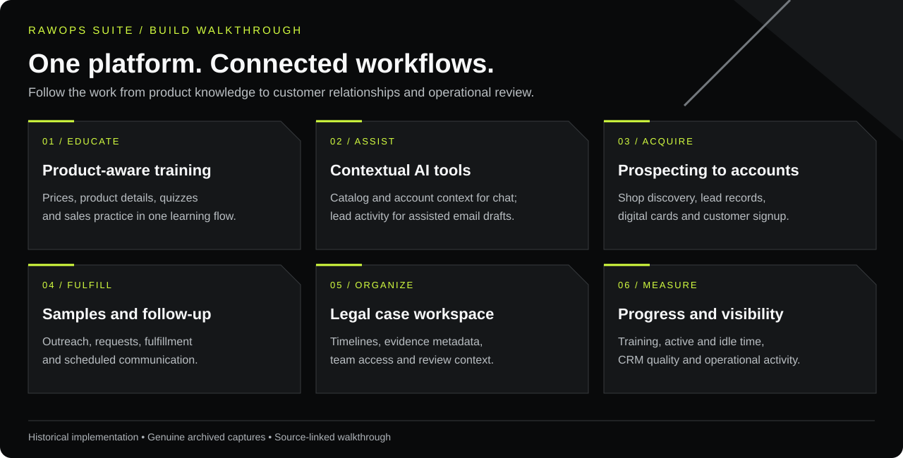

# A connected business platform

[Portfolio overview](../README.md) · [Historical screen gallery](evidence/GALLERY.md) · [All capabilities](CAPABILITY-CATALOG.md)

This walkthrough follows the work of an agent, an operations team and a legal reviewer. Each section connects a practical need to the implementation you can inspect.

## 1. Keep sales training connected to the product

**The need:** sales education had to evolve when prices, ingredients and product details changed.

I built product-aware training alongside the catalog. Training helpers read product records; shortcodes render prices, descriptions, sizes, product comparisons and calculation examples. The synchronization service updates module examples and bulk-pricing tiers and checks references and calculated fields. Courses, quizzes, completion records and sales workouts provide the learning structure.

That connection matters when an agent explains a price, compares products or practices a sales conversation. The same product information can inform the lesson, the calculation and the customer conversation.

**Implementation detail:** synchronization applies to products enabled for training. The service can flag missing module references for manual integration. The archive does not establish that every catalog edit path automatically invoked synchronization. Ingredient-related education evolved with the product; the source demonstrates dynamic product fields and synchronization tools, alongside authored lesson content.

Inspect [training helpers](../required/training-helpers.php), [shortcode rendering](../required/shortcode-engine.php), [training synchronization](../required/training-auto-sync.php), [learning modules](../onboarding/trainee/modules/), [quiz submission](../api/training-quiz-submit.php) and [sales workouts](../onboarding/trainee/sales-workouts.php).

[See the historical training progression screen](evidence/GALLERY.md#training-progression--14-september-2025).

Explore the [Product Formulator, LMS, training and marketing design case](PRODUCT-LEARNING-DESIGN.md) for the shared-data relationships, source references and design-review questions.

## 2. Find shops and prepare relevant outreach

**The need:** an agent needed to locate suitable businesses, build useful lead records and prepare a relevant first contact.

The prospecting tools support shop-category and location searches through a Google Places adapter. The adapter includes nearby searches, text searches, place details, categorization and cached results. CRM pages provide the working record: business details, assignment, tags, calls, notes, tasks and follow-up activity.

The email composer brings that context into drafting. Its generation path can load product prices and descriptions, lead activity, recent sample drop-offs and active promotions. Agents can save drafts and choose templates, tone and workflow options.

**Why it matters:** research, record keeping and communication share context. Lead-detail and follow-up-chain reporting also make incomplete records visible to the team.

Inspect [Places search and caching](../api/google-places-proxy.php), [sales leads](../onboarding/sales-agent/leads.php), [email generation and drafts](../api/ai-email-composer.php) and [lead-detail schema](../migrations/2025-10-14-lead-detail-tracking-and-chaining.sql).

[See lead completeness and follow-up counts](evidence/GALLERY.md#crm-data-quality--20-october-2025).

## 3. Put assistance inside the sales workspace

**The need:** agents and customers needed help understanding products, prices and the next step.

The chat implementation supplies the model with catalog entries, wholesale prices, MSRP, descriptions and relevant account context. The streamlined handler also includes account approval and recent-order context when available. Conversation history accompanies the request.

The email assistant has its own workflow. It generates content, stores generation metadata, saves drafts and supports follow-up generation using prior email behavior. Its prompt explicitly tells the model to use active promotions and avoid inventing coupon codes. That is a prompt-level instruction; output still needs review.

**Why it matters:** the integration connects assistance to application data and an actionable interface. Historical provider/model names remain in the preserved source and need updating before a new deployment.

Inspect [contextual chat handler](../api/ai-chat-streamlined.php), [chat variants](../api/ai-chat-v2.php) and [email assistant](../api/ai-email-composer.php).

[See the assistant interface](evidence/GALLERY.md#sales-assistant--24-october-2025) and [email customization controls](evidence/GALLERY.md#assisted-email-composition--28-october-2025).

## 4. Carry a free sample through the customer journey

**The need:** offering a free sample had to lead into organized follow-up, fulfillment and a possible store account.

The sample suite connects outreach enrollment with lead context, request handling, fulfillment status and scheduled communication. Agents have request-entry and request-history pages. Operations has a fulfillment workspace. Account and contact pages support the continuing customer relationship.

An important design decision separated email kickoff from physical sample requests. An outreach enrollment could reference a lead without creating a placeholder fulfillment job. This keeps the operations queue aligned with actual requests.

**Why it matters:** the initial offer, physical handoff and follow-up remain connected while retaining distinct statuses and responsibilities.

Inspect [sample suite](../api/sample-suite.php), [request API](../api/sample-request-api.php), [fulfillment](../operations/sample-fulfillment.php), [scheduled follow-up](../scheduled/sample-email-automation.php), [store accounts](../onboarding/sales-agent/accounts.php) and the [engineering case notes](ENGINEERING-CASE-NOTES.md).

## 5. Give every agent a useful digital business card

**The need:** a sales agent needed a shareable identity and an easy path from an introduction to the next action.

Each card offers a personalized public page with contact options, vCard download, customer signup and a free-sample entry point. The build also includes QR generation and card interaction tracking. The public card passes the agent slug into signup and sample links.

**Why it matters:** the card extends the agent's workspace into a customer-facing entry point and preserves referral context for subsequent flows.

Inspect the [public card](../agent/card.php), [card editor](../onboarding/sales-agent/my-business-card.php), [card API](../api/business-card-api.php), [QR generator](../api/business-card-qr-generate.php) and [vCard output](../api/business-card-vcard.php).

[See a genuine card with personal details redacted](evidence/GALLERY.md#agent-digital-business-card--24-october-2025).

## 6. Organize legal work for review

**The need:** a case required a coherent chronology, supporting material and a practical way to collaborate with lawyers.

I used this workspace to retain timeline data and evidence and present the material in a cleaner, more organized form for lawyers. In that work, it reduced the extra sorting needed to understand the records. This is my firsthand account of its use; no quantified time or fee savings are claimed.

The implementation includes:

- Case records, case numbers, parties and assigned team members.
- Evidence and document metadata, descriptions and timeline dates.
- A timeline interface with horizontal and vertical views, sorting and an evidence locker.
- Notes, mentions and case communication.
- External access requests and approval handling.
- Legal-role and case-membership checks, plus session activity tracking.

**Why it matters:** reviewers can approach the chronology and supporting records within one organized workspace. This preserves the practical context of evidence preparation without publishing the underlying matter.

Inspect [case access checks](../required/legal-permissions.php), [case services](../required/legal-case-service.php), [evidence locker](../admin/legal/evidence-locker/index.php), [evidence metadata](../api/legal/update-evidence-metadata.php), [team assignment](../api/legal/assign-team-member.php) and [legal session tracking](../required/legal-session.php).

[See the redacted timeline and access interface](evidence/GALLERY.md#legal-evidence-timeline--6-october-2025). All case identities, timeline entries and document titles are covered. Private evidence files are excluded. The showcase makes no claim about legal outcomes, evidentiary admissibility or certified chain of custody.

## 7. Make progress and operational gaps visible

**The need:** managers needed to understand where work stood, where records were incomplete and where someone might need help.

| Measurement | Implementation and purpose |
|:--|:--|
| Learning progress | Module completion, quizzes and sessions provide a view of agent preparation. |
| Training time | Heartbeats record activity and idle state. Alerts flag long module sessions for review. |
| Legal session time | Session records distinguish active, idle and total time and retain page context. |
| CRM quality | Detailed/incomplete lead counts and missing contact fields identify follow-up work. |
| Sales activity | Agent page tracking, pipeline stages and account/lead context support operational review. |
| Email behavior | Queue status, provider events and follow-up history help trace communication. |
| API usage | Usage records and limits support visibility into provider consumption. |

The historical operations capture displays **51 leads, 10 sales agents and 16 users in training** in its selected window. A later CRM quality capture displays **143 detailed leads, 241 incomplete leads and 69 email chains**. They are separate dated snapshots and are not a growth comparison.

Activity time is an interaction measure, not proof of productivity or a payroll calculation. Email engagement is not equivalent to a sale.

Inspect [training heartbeat](../api/training-heartbeat.php), [usage analytics](../api/admin-usage-analytics.php), [agent activity](../api/sales-agent-page-tracking.php), [email analytics](../api/email/analytics.php) and [API usage in the Places adapter](../api/google-places-proxy.php).

## 8. Define access and privacy boundaries

The system separates customer, agent, trainee, administrator and legal workspaces. The legal helper requires an administrator role or a legal role with case membership. The card API checks agent/admin roles; the training heartbeat checks that the supplied user matches the signed-in user.

These are concrete controls visible in the source. The historical evidence-locker page also has a broader role-based auto-unlock path. Consistent case-level enforcement across routes, files and deployment remains a restoration requirement. The portfolio preserves those boundaries in its presentation: synthetic contact examples, opaque screenshot redactions and exclusion of credentials, customer exports and private evidence.

[Security and privacy review](SECURITY-AND-PRIVACY.md) · [Evidence methodology](evidence/README.md)

## Continue exploring

The [capability catalog](CAPABILITY-CATALOG.md) covers the wider build, including inventory, production, accounting, suppliers, invoices, commissions, customer portals and website presentation. [Workflow diagrams](WORKFLOWS.md) show the handoffs. [API source index](API-INDEX.md) provides a direct route into the implementation.
