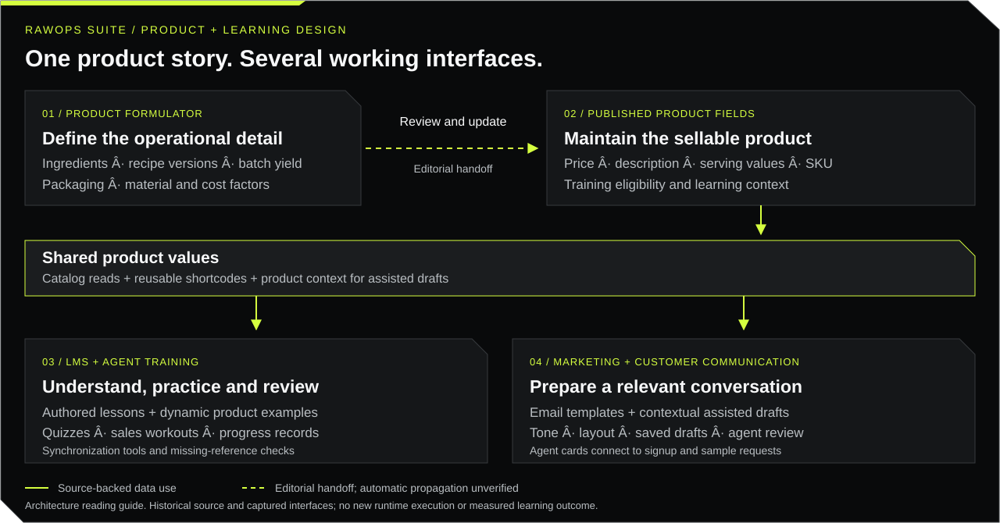

# From product formulation to informed customer conversations

[RawOps Suite](../README.md) · [Historical screens](evidence/GALLERY.md) · [Capability catalog](CAPABILITY-CATALOG.md)

**For a design reviewer:** follow one product through its operational definition, learning content, agent practice and customer communication. This case shows how I organized a complex business application around information that changes over time.

I use **Product Formulator** here to describe the related product-group, ingredient, recipe and product-editing tools in the archive. The public source preserves these as several connected workspaces. The learning management system (LMS) supplies the content structure; training supplies the agent's learning and practice experience; marketing materials include rendered email templates, assisted drafts and shareable agent cards.

## The design problem

A product change has consequences beyond the product editor. An agent may learn an old price, practice with an outdated example, or send a message that disagrees with the catalog. My design connected reusable product values to learning and communication while retaining tools for authored explanations, practice and review.

The implementation gives a reviewer several concrete design decisions to examine: where information is maintained, how each role encounters it, how a lesson becomes a practical action, and how assisted content receives relevant context.

## Follow the relationship

| Layer | What was built | Design purpose and source |
|:--|:--|:--|
| **Product Formulator** | Product-group cost factors, ingredient records, version-labeled recipes, ingredient/packaging/material lists, batch yield and estimated production time. Product editing includes wholesale/MSRP, descriptions, serving calculations and training settings. | Separate operational recipe detail from the information an agent needs to explain a product. Inspect the [group editor](../admin/product-group-editor.php), [recipe editor](../operations/product-group-recipe-editor.php) and [product editor](../admin/edit-product.php). |
| **LMS authoring** | Module titles, duration, order and required status; authored lesson content; reusable shortcodes for catalog values. | Let an author structure the explanation while shared values supply prices, descriptions, comparisons and calculations. Inspect the [content manager](../admin/lms-content-manager.php), [shortcode engine](../required/shortcode-engine.php) and [module rendering](../onboarding/trainee/module.php). |
| **Training and practice** | Lessons, quizzes, assessments, sales workouts, completion records and active/idle session tracking. Synchronization tools update enabled-product examples and pricing tiers and flag missing references. | Connect product knowledge to agent preparation, then expose progress for review. Inspect [training synchronization](../required/training-auto-sync.php), [reference checks](../required/training-sync-checker.php), [quiz submission](../api/training-quiz-submit.php) and [sales workouts](../onboarding/trainee/sales-workouts.php). |
| **Marketing and assistance** | Email templates can render the same shortcode system. Assisted drafts receive catalog, lead activity, sample and promotion context. Tone, layout and draft controls support agent review. Cards provide contact, signup and sample entry points. | Carry relevant product knowledge into a customer-facing interaction. Inspect the [template renderer](../required/email-template-renderer.php), [drafting handler](../api/ai-email-composer.php), [chat context](../api/ai-chat-streamlined.php) and [agent card](../agent/card.php). |

**Relationship boundary:** recipes, product groups and sellable product records are related data structures. The preserved source does not establish an automatic recipe-to-catalog publication pipeline. Catalog-backed shortcode rendering is directly implemented in both lesson and email rendering. Synchronization is available for enabled products; invocation on every edit path remains unverified. Ingredient explanations and other authored prose still need editorial review.

## A concrete review scenario

Suppose a product's formulation and wholesale price change. This is an illustrative review exercise using the existing design, with no new execution claimed:

1. Review the recipe version, ingredient quantities, batch yield and product-group costs in the operational workspace.
2. Confirm which sellable product fields require an approved update, including price, description, serving information and training eligibility.
3. Inspect a lesson's product shortcodes and reference checks. Shared values can update when rendered; authored explanations and quizzes require a separate consistency review.
4. Compare the lesson with an email template using that product. Review any generated draft against the current catalog, valid promotion terms and the recipient's context.
5. Check learning progress and communication records to identify follow-up work. These records describe activity; they do not establish learning gains or sales attribution.

This is a useful interview walkthrough because one change exposes the information model, interface decisions, content maintenance and human review requirements.

## Preserved interface evidence

<table><tr>
<td width="50%" valign="top">
<strong>Learning progression</strong> Completed and in-progress modules. The historical duplicated numbering remains visible.
</td>
<td width="50%" valign="top">
<strong>Customer communication</strong> Templates, assisted writing and presentation controls.
</td>
</tr></table>

The [operations capture](evidence/GALLERY.md#operations-workspace--26-october-2025) adds context for the operational workspace. There is no preserved dedicated Formulator screen in the published gallery; its detailed evidence is the source. These dated images show interface states, with identities covered. They do not demonstrate a newly executed cross-system update or the accuracy of generated responses.

## What an AI Tutor, Design reviewer can evaluate

This case offers material for discussing design judgment, instructional clarity and critique of assisted experiences. It does not claim prior employment evaluating models or measured model-quality improvements.

| Review lens | Evidence to discuss | Example of useful critique |
|:--|:--|:--|
| Information hierarchy | Product editing, module authoring, lesson progression and composer controls | Show the learner the price and comparison needed for the task; keep production-cost detail in the appropriate workspace. |
| Consistency | Shared product fields, shortcode rendering and reference checks | Identify where a live value is reused and where authored text can become stale. |
| Instructional design | Lessons, quizzes and practical sales workouts | Explain the progression from knowing a product to handling a customer question; inspect whether the assessment tests that skill. |
| AI-assisted interaction | Context assembly, tone/layout choices, saved drafts and prompt constraints | Check factual alignment, relevance and unsupported claims before accepting a draft. Prompt instructions alone cannot guarantee correctness. |
| Constructive feedback | Historical screens, including visible imperfections | Describe the problem, its effect on the user and a specific improvement that can be checked. |

**Ask me to explain:** Which values should be shared? Which changes need an editor? How would I critique an inaccurate draft? What would make a training screen easier to understand? I can trace each answer to the preserved implementation and explain the next validation step.

[Review the wider workflows](FEATURE-WALKTHROUGH.md) · [Security and restoration boundaries](SECURITY-AND-PRIVACY.md) · [Evidence methodology](BUILD-EVIDENCE.md)
