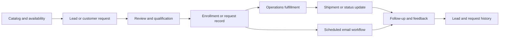
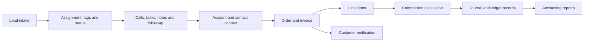
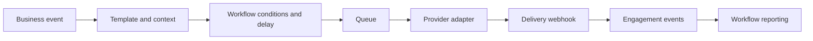
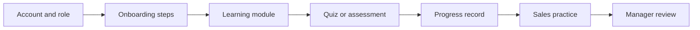
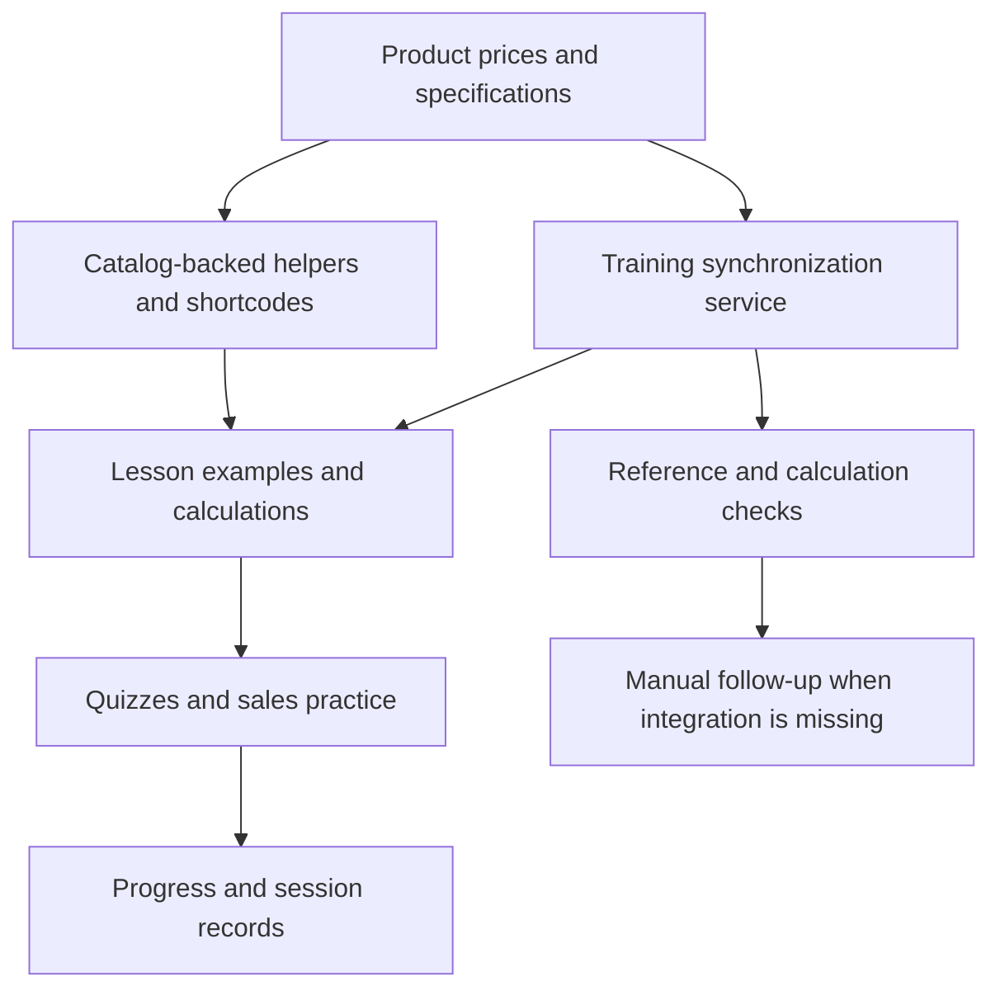
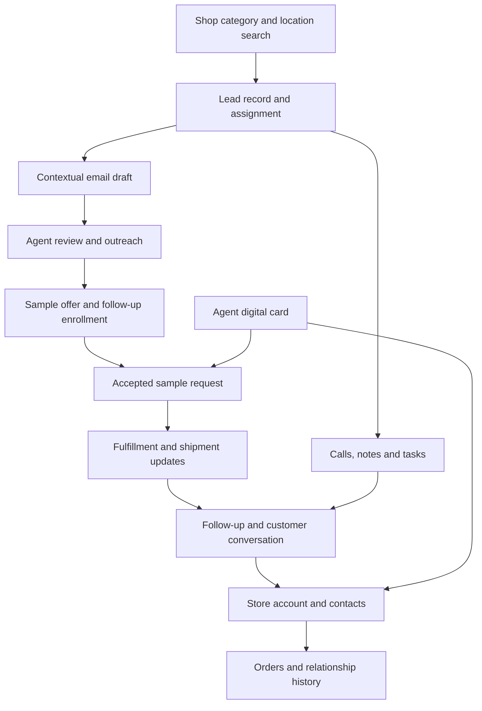
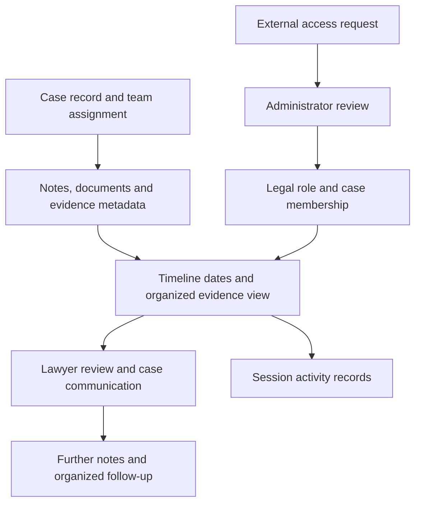

# Workflow maps

These maps are derived from application pages, API handlers and migration artifacts in this repository. They show intended record handoffs represented by the source. They are not runtime traces.

## Request to fulfillment

Source references: api/sample-request-api.php, api/sample-suite.php, operations/sample-fulfillment.php, scheduled/sample-email-automation.php, onboarding/sales-agent/my-sample-requests.php.

## Lead to order to finance

Source references: onboarding/sales-agent/leads.php, api/sacp1015-kanban-data.php, onboarding/sales-agent/invoice.php, required/commission-utils.php, api/accounting/.

## Email automation lifecycle

Source references: api/email-workflow-api.php, api/email-workflow-builder-api.php, api/email-workflow-processor.php, api/email-queue-processor.php, api/sendgrid-webhook.php, api/email/analytics.php.

## Training and onboarding

Source references: onboarding/trainee/, api/training-quiz-submit.php, api/training-save-session.php, api/walkthrough-api.php, api/sales-workouts-api.php.

## Handoff design

Shared record identifiers and explicit status changes connect these workflows. The source includes transaction handling around order and commission work, queue-based email processing, and role-oriented pages. The migration archive shows schema changes made to support these handoffs. Actual data movement in a live deployment is not visible in this repository.

## Product information to agent readiness

The source supports dynamic fields and synchronization tools. Authored content and missing references still need maintenance; this diagram does not imply every catalog edit triggers a complete curriculum rewrite.

Source: [shortcodes](../required/shortcode-engine.php), [training sync](../required/training-auto-sync.php), [heartbeat](../api/training-heartbeat.php).

## Prospecting to a continuing store relationship

This is a business journey supported by separate application workflows. Account creation and conversion are deliberate actions; the diagram does not imply that a sample automatically creates a customer or sale. Email-only enrollment is kept separate from fulfillment requests.

Source: [Places adapter](../api/google-places-proxy.php), [composer](../api/ai-email-composer.php), [sample suite](../api/sample-suite.php), [card](../agent/card.php), [accounts](../onboarding/sales-agent/accounts.php).

## Case organization and review access

The legal workspace was used to organize case material for lawyers. The public captures conceal the matter itself. Access helpers and metadata code support review of the design; private evidence and attorney communications remain excluded.

Source: [permissions](../required/legal-permissions.php), [metadata](../api/legal/update-evidence-metadata.php), [access actions](../api/legal/access-request-action.php), [session tracking](../required/legal-session.php).

## Reading these maps

Arrows describe supported handoffs and intended relationships. They do not measure execution, timing or conversion. The [feature walkthrough](FEATURE-WALKTHROUGH.md) pairs each journey with source and historical screen evidence.

