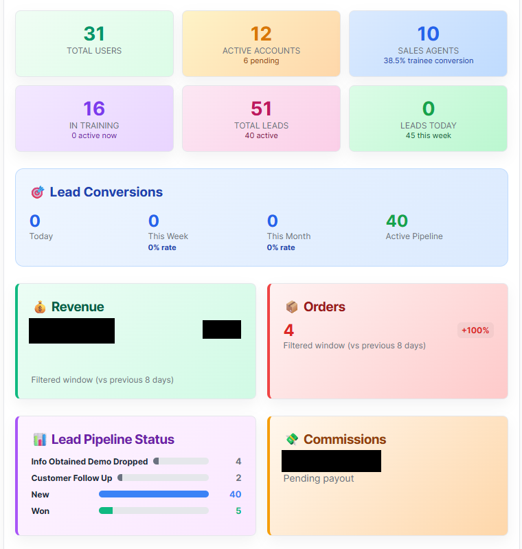
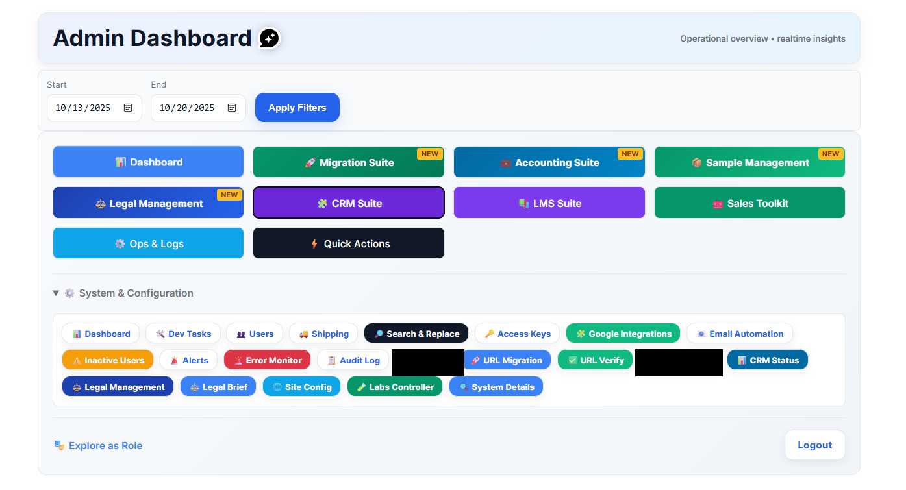
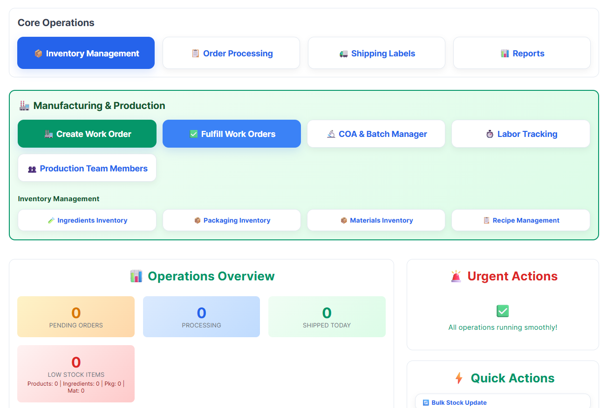
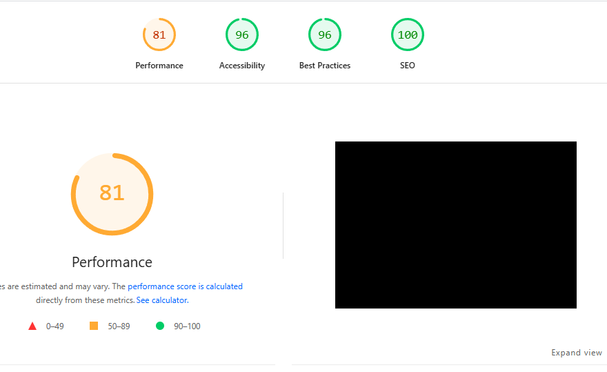
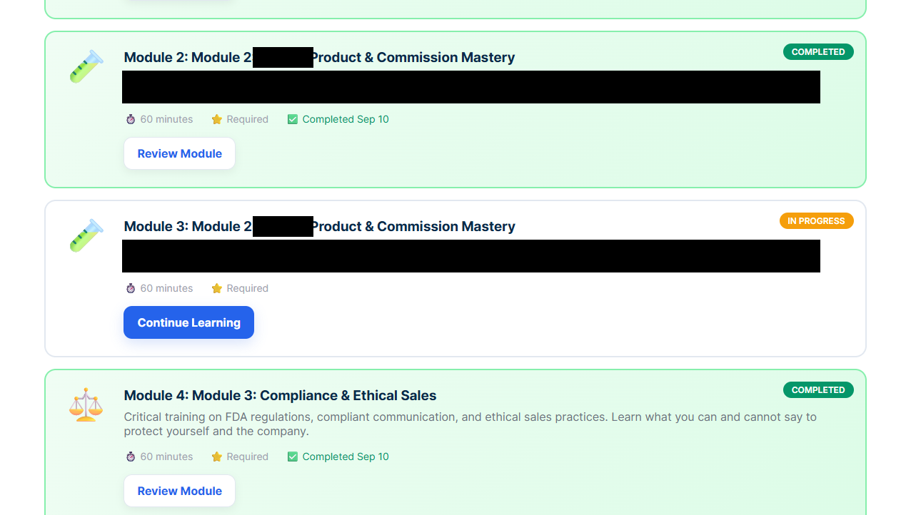
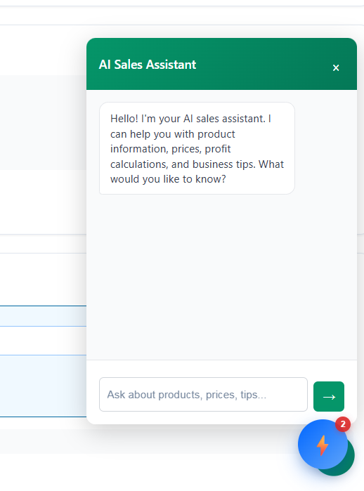
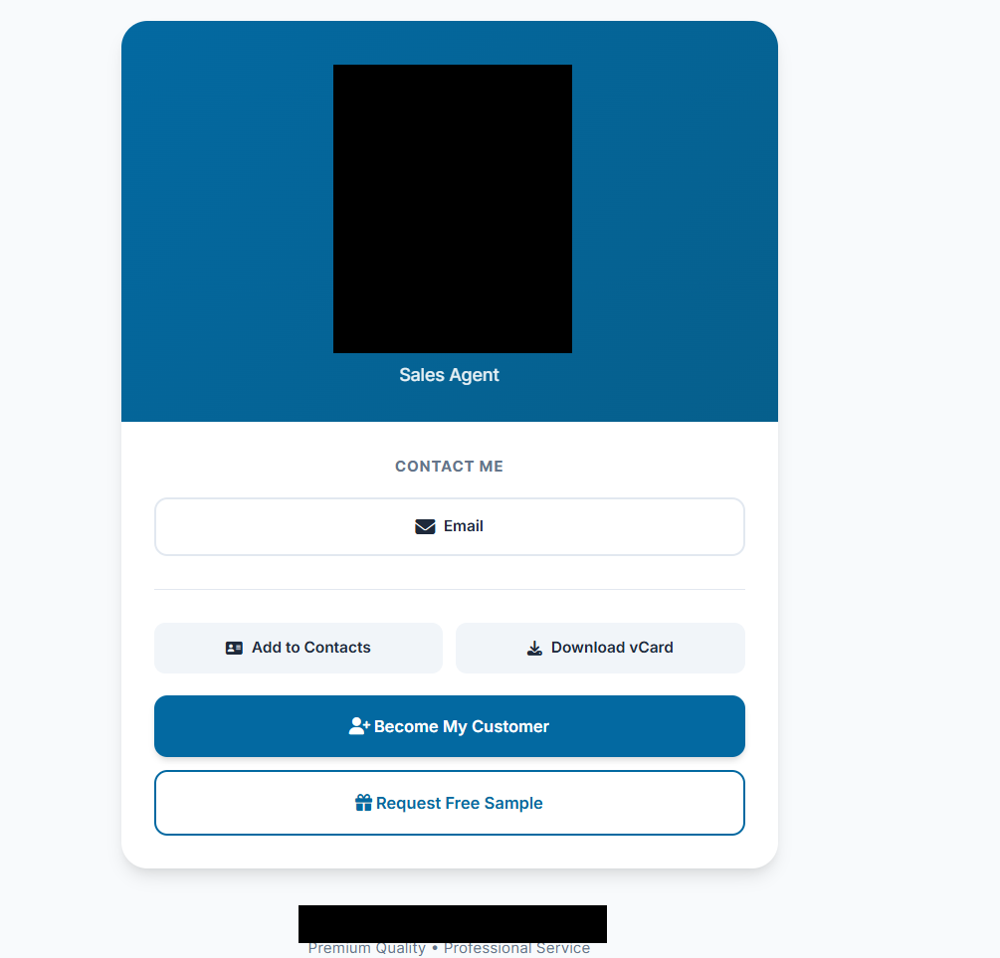
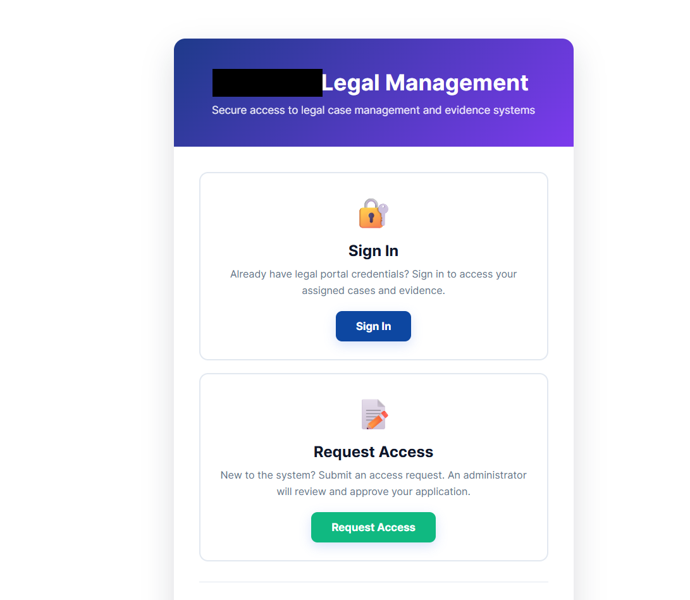
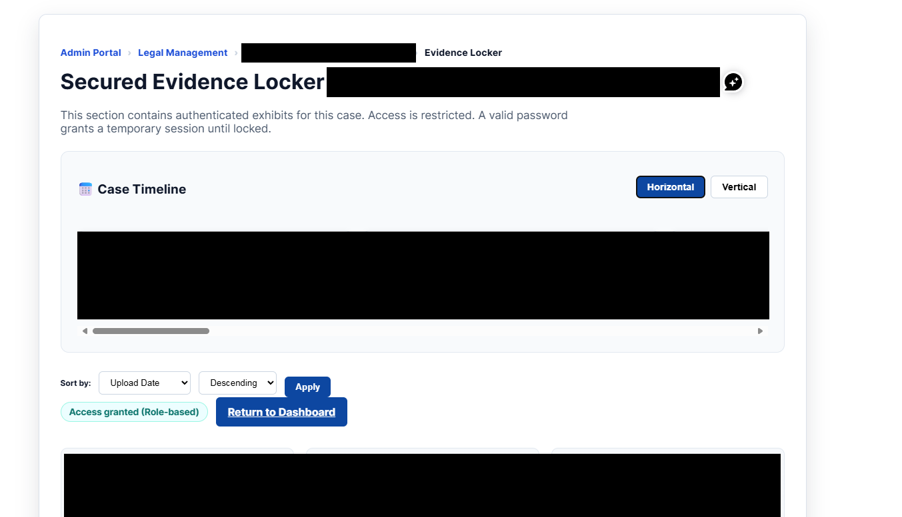

# Redacted historical evidence

These are genuine captures from the local screen archive. Redactions use solid black rectangles. The source captures remain outside this repository.

The former live site is offline and business activity has ended. These preserved captures remain historical evidence. [Operating history and archive dates](../OPERATING-HISTORY.md).

## Operating overview · 29 September 2025

This dashboard capture shows user, account, lead, agent and training counters as they appeared in the historical filter window. Monetary values are obscured. The counts are a point-in-time operating snapshot and do not establish current activity, revenue or campaign performance.

## CRM data quality · 20 October 2025

The panel shows aggregate lead-detail completeness and follow-up-chain counts. It contains no individual lead records.

## Admin module navigation · 20 October 2025

This capture shows the suite areas available from the admin dashboard. Debug and diagnostics controls are covered because those utilities were removed from the public archive.

## Operations workspace · 26 October 2025

This capture shows inventory, order, shipping, work-order, production and materials-management navigation. The counters reflect the original screen state at capture time.

## Website quality audit · 31 October 2025

The historical Lighthouse capture displays Performance 81, Accessibility 96, Best Practices 96 and SEO 100. The site preview was fully covered to remove the former brand and product imagery. These scores represent one dated audit capture, not a current or sitewide guarantee.

## Training progression · 14 September 2025

The archived learning interface displays completed and in-progress modules, expected duration, required status and review/continue actions. Product-specific text is covered. The repeated module numbering is retained as captured. This image demonstrates the historical interface; the catalog-driven behavior is documented in the [feature walkthrough](../FEATURE-WALKTHROUGH.md#1-keep-sales-training-connected-to-the-product).

## Sales assistant · 24 October 2025

The embedded assistant offers help with product information, prices, profit calculations and business questions. This capture shows its welcome state. Context assembly and model calls are reviewable in the [chat handler](../../api/ai-chat-streamlined.php); the welcome message alone does not demonstrate a generated response.

## Assisted email composition · 28 October 2025

The composer exposes template loading, assisted writing, creative layout changes, custom tone, a sales-special option and header/footer controls. The recipient and an identifying product option are covered. The [composer source](../../api/ai-email-composer.php) includes generation, saved drafts and follow-up handling.

## Agent digital business card · 24 October 2025

A real card displays email contact, contact download, vCard export, customer signup and free-sample actions. The company name, agent identity, portrait and identifying footer are covered. The [public card source](../../agent/card.php) shows agent context passed into signup and sample links.

## Legal access portal · 6 October 2025

The entry screen separates existing-user sign-in from an administrator-reviewed access request. The original company name is covered. Review the [access helper](../../required/legal-permissions.php) for role and case-membership checks.

## Legal evidence timeline · 6 October 2025

The preserved evidence-locker interface includes a case timeline, horizontal/vertical viewing options, sorting and a role-access indicator. All case identities, timeline contents and visible document titles are covered. The underlying case records and evidence files are excluded.

This capture supports the existence of the working interface. The [legal walkthrough](../FEATURE-WALKTHROUGH.md#6-organize-legal-work-for-review) describes my firsthand use of the system to retain chronology and organize evidence for lawyers.

## Evidence limits

The captures show real screens from the archived system. They do not independently establish present-day availability, current database contents, successful third-party delivery, customer outcomes or production security. Feature details and code references are in the [capability catalog](../CAPABILITY-CATALOG.md) and [build evidence guide](../BUILD-EVIDENCE.md).

